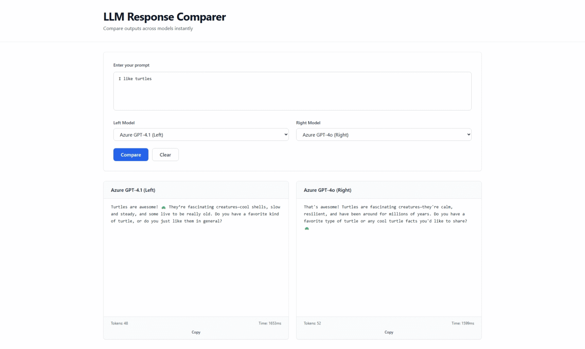

# LLM Response Comparer



Compare two OpenAI or Azure OpenAI models with independent live text, token counts, and response times. Express serves a static frontend; no build step is required.

## Run

Requires Node.js 22+ and npm.

```powershell
npm ci
Copy-Item .env.example .env
# Configure credentials in .env, then:
npm start
```

Open [localhost:3001](http://localhost:3001). `PORT` overrides the port. Use `npm run dev` for Node's native server watcher and `npm test` for regression tests with mocked providers and local HTTP servers.

### Configure providers

Configure either provider or both, then restart. Unused credentials can stay empty. The app starts without credentials; comparing requires at least two configured model choices. The picker lists configured models without checking account access.

**OpenAI:** Set `OPENAI_API_KEY`. `OPENAI_MODELS` accepts comma-separated Responses-compatible IDs and defaults to `gpt-6-astra,gpt-6-sol,gpt-6-luna`. Requests stream through the Responses API, set `store: false`, omit sampling parameters, and allow 16,384 output tokens including reasoning.

**Azure:** Each of the two optional slots uses these variables (replace `1` with `2` for the second):

| Variable | Value |
| --- | --- |
| `MODEL_1_ENDPOINT` | Required resource URL, e.g. `https://resource.openai.azure.com` |
| `MODEL_1_API_KEY` | Required resource key |
| `MODEL_1_DEPLOYMENT_ID` | Required deployment name |
| `MODEL_1_NAME` | Display label; defaults to deployment name |
| `MODEL_1_MODEL` | Underlying model ID; set this when the deployment name is custom |
| `MODEL_1_API_VERSION` | Deployment-supported version; defaults to `2025-01-01-preview` |

Azure uses Chat Completions. The GPT-5/GPT-6 and o1/o3/o4 model families use `max_completion_tokens: 16384` without temperature; other models use `max_tokens: 2000` and `temperature: 0.7`. Model availability and API-version support depend on your deployment.

## Use

Enter a prompt, choose two different models, and click **Compare** or press Ctrl+Enter (Cmd+Enter on Mac). Each panel streams independently. **Clear** cancels the requests; **Copy** copies a panel's text.

Metrics arrive as each side finishes. Tokens come from provider usage, including OpenAI reasoning tokens; Azure estimates missing usage and marks it `~`. Errors preserve partial text and let the other model continue. Incomplete responses and dropped streams are reported.

After a comparison finishes, **Save comparison** stores its prompt, model IDs and names, responses, metrics, and any errors in this browser. Saved comparisons can be opened or deleted, and the current result or any saved entry can be exported as JSON or Markdown. Opening a result does not call the models again; unavailable models must be reselected before rerunning.

Saving is manual, with a limit of 100 entries and no automatic deletion. Browser storage is specific to this site's address and browser profile; clearing site data removes saved results. Storage errors leave existing entries untouched, and exports remain available if saving is blocked or storage is full. Prompts and responses may contain sensitive information; save and share exports accordingly.

Keys stay in the ignored `.env` file. The app has no authentication or rate limiting: configure access controls before exposing it publicly. Styling loads Tailwind from its CDN.

## API and streaming

- `GET /api/models` returns configured IDs, names, and provider types without credentials. OpenAI IDs are `openai-<model-id>`; Azure retains `azure-gpt-4-model-1` and `azure-gpt-4-model-2` for any model in those slots.
- `GET /api/health` returns status and timestamp.
- `POST /api/compare` accepts JSON `{ "prompt": "...", "leftModel": "...", "rightModel": "..." }`. Use distinct IDs from `/api/models`; invalid input returns HTTP 400 before streaming.

Comparison responses contain JSON in SSE `data:` lines:

| Type | Payload |
| --- | --- |
| `chunk` | `side` (`left` or `right`), `content` |
| `metrics` | `left` or `right` metadata with `duration` in ms, `tokenCount`, and `completed`; Azure also reports `estimated` |
| `error` | `side`, `message` |
| `complete` | `success`, false if either side failed |

SSE comments send heartbeats every 15 seconds. Responses set `X-Accel-Buffering: no`; configure proxies to honor streaming. Provider clients use a 120-second timeout, and browser disconnects abort upstream requests.

Implementation: `server.js` serves `public/` and mounts `routes/api.js`; `services/` handles providers; `test/` covers streaming, cancellation, errors, and frontend decoding. There are no configured build, lint, or type-check commands.

## License

MIT
